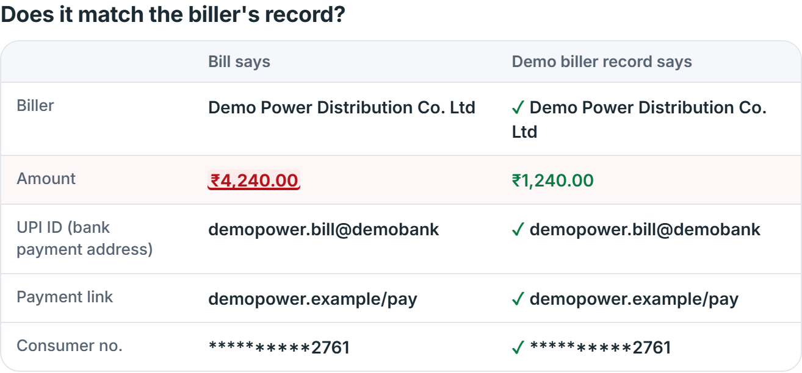
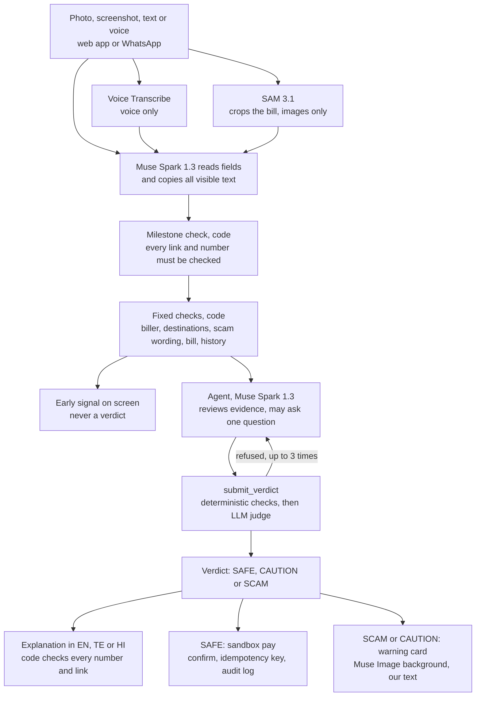

# BillSaathi

**An AI agent that checks an Indian bill or payment request before you pay: it verifies it against the biller's records, catches scams before money moves, and explains the verdict in your language.**

Built from scratch Oct 26 – Nov 4, 2026 for the Meta Global AI Developer Hackathon (Startup track, "Build for Your World"), solo; not affiliated with any other product using a similar name.

> **Built during the hackathon.** Everything in this repository was built during the event, Oct 26 to Nov 4, 2026. Nothing pre-existing was used apart from public libraries. See the commit history.
>
> **Sandbox demo.** See [exactly what is simulated](#exactly-what-is-simulated). All billers, bills and test data are synthetic, and no real money moves.

## Live links

| | |
|---|---|
| Web app | https://zealous-coast-09279dd00.1.azurestaticapps.net |
| Evaluation | https://zealous-coast-09279dd00.1.azurestaticapps.net/eval |
| Privacy policy | https://zealous-coast-09279dd00.1.azurestaticapps.net/privacy |
| API health | https://ca-billsaathi-api.orangeocean-70e70440.centralindia.azurecontainerapps.io/api/v1/health |

## How to test, in 30 seconds

1. Open the [web app](https://zealous-coast-09279dd00.1.azurestaticapps.net) and press **Watch a scam get blocked**. The steps stream in with their model and timer, an amber "Possible fraud found" appears, then a red **SCAM**. The panel compares what the message says with what the demo biller record says.
2. Press **Try a genuine demo bill**: SAM 3.1 finds the bill in a phone photo, every row matches, you get **SAFE**, and you can simulate a payment after confirming.
3. In **Try a sample**, pick **Tampered bill**: the same account with one changed amount, so exactly one row differs and the verdict is **CAUTION**. Then try the voice note, or **See the judge catch an over-claim**, a replay of a real recorded run.

Switch to తెలుగు or हिंदी, or turn on **Privacy Mode** in the top bar. More messages to paste are in [docs/TESTING.md](docs/TESTING.md). Please send only synthetic data: a real bill ends as CAUTION by design.



## Exactly what is simulated

| Real | Simulated |
|---|---|
| Every Meta model call, the agent loop, the verification layers, the deployed web app and API, the WhatsApp number | The biller registry, bills and history: 8 synthetic billers in a mock we built. **We are not connected to the real BBPS network** (India's national bill-payment network) |
| The risk rules and the evidence record | Payments: sandbox only, no real money moves. The receipt and audit row are real records of a simulated payment |
| The measured evaluation, on real runs | The test data: 60 labelled synthetic items. The known-scam list and scam patterns are small and synthetic |

## The problem

Indians lost [₹22,845 crore to cyber fraud in 2024, up 206% in a year](https://www.theweek.in/wire-updates/business/2025/07/22/del23-lsq-cyber-fraud.html) (Ministry of Home Affairs, reply in the Lok Sabha, July 2025). That figure covers all cyber fraud. Fake bills are one common route: "your power will be cut tonight, pay now", sent to people who may be new to digital payments and may not read English.

## How it works



FastAPI on Azure Container Apps (Central India); Next.js static site on Azure Static Web Apps. Web and WhatsApp share one pipeline.

## Which Meta model does what

| Model | Job |
|---|---|
| **Muse Spark 1.3** | Reads bills and messages, runs the tool-calling agent, judges its reasons, explains the verdict |
| **SAM 3.1** | Crops the bill out of a phone photo (concept "document"); falls back to the original image |
| **Muse Voice Transcribe** | Voice input, always with `languageBias` for the user's language |
| **Muse Spark Open** (open weights, hosted on Baseten, with Fireworks as fallback) | Privacy Mode: the whole pipeline with no call to Meta's Model API. It runs on an external host, so it is not offline or on-device |
| **Muse Image** | Background of the warning card, from a fixed prompt with no user data and all tools off; our code draws the text |

Contributor models, which train on inputs, are refused in code.

## Verification layers

**The model proposes, the code verifies.** Each layer can only make the outcome stricter. Design: [docs/AGENT_DESIGN.md](docs/AGENT_DESIGN.md).

1. **Fixed checks at fixed points.** Code runs the biller lookup, a check of every destination, scam wording, bill fetch and history before the agent's first turn. The agent cannot skip them.
2. **Milestone check.** Any link, UPI ID or phone number in the text that reading missed is added and must be checked. It reads the original image even when the fields read SAM's crop, so cropping cannot hide a link.
3. **Deterministic checks in `submit_verdict`.** Citations must exist in this run, every destination must be checked, the verdict can never go below the risk-engine floor, and SAFE needs every hard check to pass.
4. **Independent judge.** A separate model call checks that each reason says only what its evidence says. It can only refuse, and it fails closed.
5. **Forced CAUTION.** Three refusals, a failed tool, a limit or an outage ends as CAUTION, or the floor if stricter. Never SAFE.
6. **Checked explanations.** Code rejects any number, link or UPI ID not in the evidence, and any reply not in the user's script, then falls back to a template. Helpline numbers come only from a vetted list in code.
7. **The user signs off.** Nothing is paid without explicit confirmation. Payments are idempotent, and every attempt is a row in an append-only audit table whose triggers refuse updates and deletes.

## Evaluation

The real pipeline on the **test split: 21 held-out synthetic items** never used for tuning. Prompts and rules were tuned on the separate dev split (39 items). Graders are deterministic code. Full tables, method and results files: [/eval](https://zealous-coast-09279dd00.1.azurestaticapps.net/eval), [eval/](eval/).

| | Correct | Risky not called SAFE | Genuine bills passed | p50 to verdict | p90 | Cost per check |
|---|---|---|---|---|---|---|
| **Spark 1.3, low (the product)** | 21/21 | 13/13 | 8/8 | 10.9 s | 17.2 s | $0.024 |
| Spark 1.3, minimal | 21/21 | 13/13 | 8/8 | 8.5 s | 12.9 s | $0.016 |
| Spark 1.3, medium | 21/21 | 13/13 | 8/8 | 14.3 s | 19.7 s | $0.023 |
| Spark 1.3, high | 21/21 | 13/13 | 8/8 | 16.3 s | 21.5 s | $0.026 |
| Muse Spark Open (Privacy Mode) | 21/21 | 13/13 | 8/8 | 19.1 s | 23.7 s | ~$0.033 (estimate) |

**Read these honestly.** The set is small, synthetic and written by the builder, so 13/13 risky items not called SAFE (0 dangerous mistakes) still allows a true miss rate up to about 23% (95%, rule of three). The checks recorded every expected finding on 19 of 21 items; on the other 2 the biller check answered UNKNOWN_BILLER, stricter than the label expected, and the verdict was still right ([details on `/eval`](https://zealous-coast-09279dd00.1.azurestaticapps.net/eval)). Only the product row includes explanation cost. The judge ran at `low` in every row. Times are from a developer machine running three checks at once. Spark Open has no listed price, so its cost is estimated at Spark 1.3 rates. These runs came before the Nov 4 fixes below. Live speed varies: on Nov 4, two sets of six live checks had a median of 16.8 and 21.4 s to the verdict.

**Fresh challenge set.** 20 new synthetic cases, frozen before running and run once on the fixed code: 20/20 verdicts correct, with one finding missed. Every case and the limits: [docs/CHALLENGE_RESULTS.md](docs/CHALLENGE_RESULTS.md).

**Fail-closed tests.** A scripted model tries to get SAFE through registry errors, prompt injection in three languages, a known-scam destination beside an official one, and invented contacts ([api/tests/test_fail_closed.py](api/tests/test_fail_closed.py)). On Nov 4 these found that a toll-free or landline number, Indian-script digits or an uncommon domain ending could be missed. That is now fixed in the code, with no verdict changed on 80 regression inputs. Evidence for every claim: [docs/CLAIMS_AND_EVIDENCE.md](docs/CLAIMS_AND_EVIDENCE.md).

## Known limits

- All billers are mock, so **a real bill ends as CAUTION** by design. BillSaathi proves the method; it is not connected to real biller data.
- Checks, open questions, rate limits and the daily spend cap live in one process's memory, so the API runs at max 1 replica and a restart loses them. The sandbox audit log is durable: SQLite on an Azure Files share, kept across restarts and new revisions.
- Privacy Mode means open weights on an external host (Baseten; the Fireworks fallback is built but untested live), with no call to Meta's Model API. It is not offline. It skips SAM and the generated card picture, because both are on Meta's API, and it is slower.
- Scam patterns and the known-scam list are small and synthetic. New wording is left to the agent and the other checks.
- Contacts spelled in words ("nine eight seven…", "help-desk dot shop") and landlines without 0 or +91 are not detected by code.
- If the reading step reports a different amount from the one printed, code does not cross-check it against the raw text.
- WhatsApp text, photo and voice note were tested live by the builder on 2026-11-03, from the builder's phone only; other numbers are untested.
- Telugu has been rated by a native speaker on earlier samples (4/5); Hindi is approximate. Marathi and Tamil are not shipped.
- Free Meta credits may let Meta use submitted content to improve its products: send only synthetic data.

## Run it yourself

Windows, Python 3.12+, Node 24. Copy `api/.env.example` to `api/.env` and fill in your own keys.

```powershell
cd api
python -m venv .venv; .venv\Scripts\python -m pip install -r requirements-dev.txt
.venv\Scripts\python -m uvicorn app.main:app --port 8000
.venv\Scripts\python -m pytest -q        # no API calls

cd ..\web
npm ci; npm run dev                      # http://localhost:3000
npm test

cd ..\api
.venv\Scripts\python ..\eval\run_eval.py spark-low   # spends real money
```

## Repository

`api/` FastAPI app, agent, risk engine, mock BBPS, WhatsApp · `web/` Next.js app · `data/synthetic/` labelled dataset · `data/challenge/` frozen challenge set · `eval/` harness, graders, results · `infra/` Azure deployment · `docs/` design, testing, handoff · [FEEDBACK.md](FEEDBACK.md) notes on the Meta APIs.

Built by Bharat Vamsi Chillimunta (Ireesha Infosol Pvt Ltd). MIT licence.
